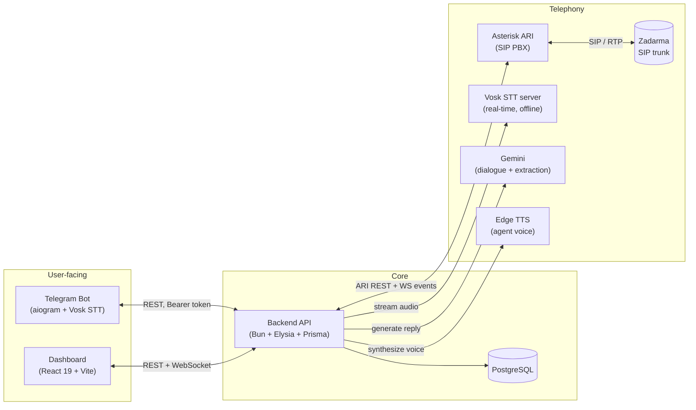

# Broni 🤖📞

**An autonomous voice AI agent that makes real phone calls on your behalf** — to book a table, schedule an appointment, or confirm a reservation — and a multi-tenant dashboard for businesses to receive and monitor those calls in real time.

You tell it what you need in Telegram ("Book a table for 2 at Del Papa, 7 PM"). It calls the restaurant, talks to a human, negotiates the booking, and reports back with a transcript and the full call recording.

[](https://bun.sh)
[](https://elysiajs.com)
[](https://www.postgresql.org)
[](https://www.asterisk.org)
[](https://react.dev)
[](#)

---

## How it works

1. **You describe the task** in the Telegram bot — as text or a voice message.
2. The **backend** extracts the structured task (place, phone, time) with Gemini and queues a call.
3. **Asterisk**, connected to a real SIP trunk (Zadarma), dials the number.
4. Once the human answers, the backend drives the conversation in a loop:
   *speak a line (Edge TTS) → listen (Vosk STT, offline, real-time) → decide the next line (Gemini) → repeat* — with **barge-in**, so the agent stops talking the instant the other person starts.
5. On hangup, the backend saves the outcome, the transcript, and the full call recording, and reports back to Telegram.

The same call engine also powers a **B2B side**: businesses sign up on the **dashboard**, get a dedicated number, and watch *inbound* calls to their line being handled by the agent live, with bookings landing straight on a calendar.



---

## Components

| Path | Stack | Role |
|---|---|---|
| [`backend/`](backend/README.md) | Bun, Elysia, Prisma, PostgreSQL | Call orchestration engine: REST API, WebSocket event bus, Asterisk ARI driver, Gemini dialogue loop, Edge TTS streaming |
| [`telegram-bot/`](telegram-bot/README.md) | Python, aiogram, Vosk | End-user chat interface — collects booking requests (text or voice), reports outcomes |
| [`dashboard/`](dashboard/README.md) | React 19, Vite, TypeScript | Operator web app — JWT auth, live call monitor over WebSocket, booking calendar |
| `Broni-landing/` | Static HTML | Marketing site (deployed separately on Vercel) |

**Data model** (`backend/prisma/schema.prisma`): `User` + `Task` back the Telegram flow; `Company` + `CallLog` + `Booking` back the multi-tenant dashboard flow — both share the same telephony engine underneath.

---

## Quick start (Docker)

Everything is containerized. You need Docker, a [Gemini API key](https://aistudio.google.com/), a Telegram bot token, and a SIP trunk (the project is wired for [Zadarma](https://zadarma.com), but any SIP provider Asterisk supports will work).

**1. Configure secrets**

Copy the example env file at the repo root and fill it in:

```env
BOT_TOKEN=your_telegram_bot_token
GEMINI_API_KEY=your_gemini_api_key
ZADARMA_SIP_PASSWORD=your_zadarma_sip_password
ASTERISK_EXTERNAL_IP=your_server_public_ip
ASTERISK_ARI_USER=ari_admin
ASTERISK_ARI_PASS=choose_a_strong_password
API_SECRET_KEY=choose_a_strong_internal_token
```

Then open `backend/asterisk/ari.conf` and `backend/asterisk/pjsip.conf` and replace the `YOUR_*` / `CHANGE_ME_*` placeholders with the **same** ARI password and your real Zadarma SIP credentials — Asterisk reads these from static config files, not environment variables.

**2. Run everything**

```bash
docker-compose up -d --build
```

This starts PostgreSQL, Asterisk, the Vosk STT server, the backend API, and the Telegram bot.

**3. Apply the database schema**

```bash
docker exec -it ai_backend bunx prisma db push
```

---

## Local development (without Docker)

```bash
# 1. Infrastructure only (Postgres, Asterisk, Vosk)
cd backend && docker-compose up -d

# 2. Backend
cd backend && bun install && bun run dev

# 3. Telegram bot (needs the Vosk model — see telegram-bot/README.md)
cd telegram-bot && pip install -r requirements.txt && python3 second_bot.py

# 4. Dashboard
cd dashboard && bun install && bun run dev
```

---

## Why it's cheap to run

The pipeline leans on free/offline components wherever it can: **Vosk** for speech-to-text (fully offline, no per-minute API cost) and **Edge TTS** for voice synthesis. The only metered costs are Gemini Flash (generous free tier) and the SIP trunk's per-minute telephony rate.

---

<details>
<summary><strong>🇷🇺 Краткое описание на русском</strong></summary>

**Broni** — автономный голосовой ИИ-агент, который сам совершает настоящие телефонные звонки от имени пользователя: бронирует столик, записывается к врачу или в салон, подтверждает резервацию. Пользователь описывает задачу текстом или голосом в Telegram, агент дозванивается через SIP-транк (Zadarma) и Asterisk, ведёт диалог в реальном времени (TTS-реплика → офлайн-распознавание речи через Vosk → ответ от Gemini → повтор), умеет не молчать в ответ на перебивание (barge-in), а после звонка присылает текстовый отчёт и аудиозапись разговора.

Тот же движок звонков лежит в основе B2B-дашборда: бизнесы подключают свой номер, получают входящие звонки, обрабатываемые тем же агентом, и видят диалог и бронирования в реальном времени.

Структура: `backend/` — ядро на Bun/Elysia/Prisma, `telegram-bot/` — Telegram-интерфейс на aiogram, `dashboard/` — веб-панель на React, `Broni-landing/` — маркетинговый сайт. Подробности и переменные окружения — в README каждого компонента.

</details>
